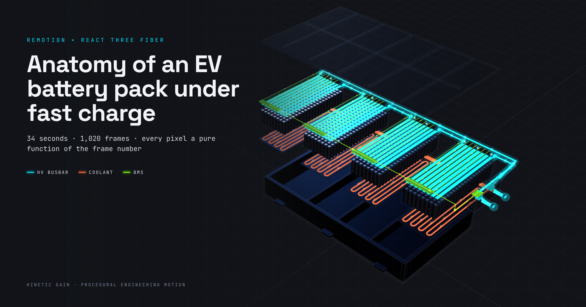

<!--
MEDIUM PUBLISHING KIT
SEO title (58 chars):   How I Built an EV Battery Cutaway in Remotion and Three.js
Medium subtitle:        A 34-second engineering animation where every pixel is a pure function of the frame number, plus the four mistakes my first render made
Custom URL slug:        remotion-threejs-ev-battery-pack-cutaway
Meta / SEO description (155 chars):
  Build a frame-accurate EV battery pack cutaway with Remotion and React Three Fiber: camera math, jelly-roll cell geometry, coolant flow, and HV busbar paths.
Medium tags (5 max):    Remotion, Threejs, React, Motion Design, Electric Vehicles
Hero image:             docs/hero-ev-pack-anatomy-jig-Cursor.png (2400×1260)
Hero alt text:          Exploded isometric render of an EV battery pack with cyan high-voltage busbars, orange serpentine coolant channels and green BMS telemetry traces on a dark slate background.
Canonical (if cross-posting): https://mizcausevic-dev.github.io/ev-pack-anatomy-jig/
Primary query:          remotion three.js animation
Secondary queries:      react three fiber remotion, procedural product animation, EV battery pack animation, battery cutaway animation
-->

# How I Built an EV Battery Cutaway in Remotion and Three.js

### A 34-second engineering animation where every pixel is a pure function of the frame number, plus the four mistakes my first render made


*Frame 1008 of the render, re-framed for a hero. No imported models: the whole pack is built from code.*

Most product animation briefs fail before anyone opens a tool. They describe a mood ("make it feel premium") instead of a contract. The brief behind this piece was the opposite. It specified 1,020 frames at 30 fps, a five-color palette with a hex code per subsystem, and five camera beats pinned to exact frame ranges.

That kind of brief deserves a renderer that treats time as data. So I built it in **Remotion** with **React Three Fiber**. Every element on screen, from the shield lift to the last pulse on the busbar, is computed from one integer: the current frame.

Here's the result: **[live preview and full video](https://mizcausevic-dev.github.io/ev-pack-anatomy-jig/)**. The source is on **[GitHub](https://github.com/mizcausevic-dev/ev-pack-anatomy-jig)**.

## TL;DR

- **Remotion** renders React to video frame by frame. **@remotion/three** gives you a `<ThreeCanvas>` that stays in sync with `useCurrentFrame()`.
- The whole timeline lives in one pure module, `sceneAt(frame)` and `cameraAt(frame)`. The 3D scene and the HTML overlay both read from it, so labels never drift from the geometry.
- The camera interpolates in spherical coordinates and lerps the distance in log space. That one change turns a 115× dolly-out from a lurch into a move.
- The final render is 1,020 frames at 1920×1080. It took 14 minutes 20 seconds on a 4-vCPU cloud VM with no GPU, using software WebGL.
- My first stills had four visible bugs. I'll show what each one was, because those fixes are the most reusable part of this.

## The brief, read as a contract

| Frames | Beat | Engineering requirement |
|---|---|---|
| 0–150 | Exterior | Slow 15° orbital sweep around a die-cast aluminum frame |
| 151–300 | Cutaway | Top ballistic shield translates up the Z axis; camera drops into module group 2 |
| 301–510 | Thermal | Serpentine coolant channels highlight in safety orange, with velocity indicators |
| 511–750 | Cell macro | A cylindrical cell is sliced; jelly-roll layers (cathode, separator, anode) peel open; BMS traces light acid green |
| 751–1020 | Exploded | Rapid dolly-out to an isometric layout; busbars light electric cyan as pack voltage converges on the contactor terminals |

The palette carried meaning, not decoration: `#00E5FF` for high-voltage busbars, `#FF6B35` for coolant, `#76FF03` for battery-management-system (BMS) telemetry, and `#3A3F4D` wireframe over a `#111318` base. When a color means a subsystem, a viewer can read the animation the way an engineer reads a schematic. That shaped every material decision that followed.

## Rule one: nothing animates by itself

Remotion's documentation is explicit about 3D. Animations must be driven by `useCurrentFrame()`, and React Three Fiber's `useFrame()` is off-limits, because anything that advances on its own will flicker when frames render out of order or in parallel. During rendering, `<ThreeCanvas>` also forces R3F's frame loop to `'never'` and redraws only when Remotion asks.

So the project has a single source of truth:

```ts
export const sceneAt = (f: number) => {
  const explode = ramp(f, 760, 880);
  const shieldSpring = spring({frame: f - 160, fps: FPS, config: {damping: 22, stiffness: 50, mass: 1.4}});
  return {
    explode,
    shieldLift: shieldSpring * 2.3 + explode * 0.5,
    coolant: ramp(f, 305, 345),
    heroLift: HERO_LIFT * ramp(f, 520, 585) * (1 - ramp(f, 752, 800)),
    converge: ramp(f, 880, 985, Easing.inOut(Easing.quad)),
    contactor: ramp(f, 985, 1002),
    // …
  };
};
```

`ramp` is a clamped `interpolate()` with an easing curve. The shield uses Remotion's `spring()`, which looks physical but is still a deterministic function of the frame. Frame 412 is always frame 412, whether you scrub to it in Studio or render it on the third of three parallel browser tabs.

The result in the repo: zero calls to `useFrame` across 1,280 lines of TypeScript.

## The camera is the hardest animator on the set

My first instinct was to interpolate camera positions in XYZ. That fails twice. A straight line between two orbit positions cuts through the object instead of arcing around it. And a linear distance lerp from 0.66 units (macro) to 19.5 units (isometric) spends nearly all its time far away, so the move feels like a jump cut followed by a crawl.

The fix is to key the camera the way a camera operator thinks: target, azimuth, elevation, distance, field of view. Then interpolate the distance in log space.

```ts
// simplified from src/timeline.ts
const target = lerpVec(a.t, b.t, t);
const r  = Math.exp(lerp(Math.log(a.r), Math.log(b.r), t)); // equal ratios per unit time
const az = lerp(a.az, b.az, t) * DEG;
const el = lerp(a.el, b.el, t) * DEG;
const position = target.clone().add(new THREE.Vector3(
  r * Math.cos(el) * Math.sin(az),
  r * Math.sin(el),
  r * Math.cos(el) * Math.cos(az),
));
```

Why log space? Perceived zoom is about ratios. Going from 1 to 2 units feels like the same zoom as going from 10 to 20. A log lerp gives each frame the same ratio of change, so the 115× dolly-out in shot five reads as one continuous pull.

Two smaller details made it work:

- **Dynamic near plane.** The camera's near clip is `max(0.004, r * 0.02)`. A fixed near plane small enough for the cell macro wrecks depth precision at isometric distance. A fixed one large enough for the wide shot clips the cell.
- **A true isometric angle.** The final key uses an elevation of 35.264°, which is `atan(1/√2)`, at a 45° azimuth with a narrow 24° field of view. It's still a perspective camera, but at that distance it reads as an engineering isometric without switching projection mid-move.

## One state function, two renderers

The overlay (titles, timecode, leader-line callouts, telemetry panel) is plain HTML layered above the WebGL canvas. Leader lines that drift off their target are the fastest way to make technical motion look cheap.

The fix is to make the HUD project 3D points through the exact same camera math the scene uses:

```ts
export const project = (f: number, v: THREE.Vector3, w = 1920, h = 1080) => {
  const c = cameraAt(f);
  projCam.fov = c.fov; projCam.aspect = w / h; projCam.near = c.near;
  projCam.position.copy(c.position); projCam.lookAt(c.target);
  projCam.updateProjectionMatrix(); projCam.updateMatrixWorld();
  const p = v.clone().project(projCam);
  return {x: ((p.x + 1) / 2) * w, y: ((1 - p.y) / 2) * h, visible: p.z > -1 && p.z < 1};
};
```

Because `cameraAt(frame)` is pure, the callout for "CATHODE" can follow the cut edge of layer 28 while that edge peels open, the cell rises, and the camera orbits. No screen-space keyframes and no manual tracking.

## Building a cell you can actually cut

A cylindrical lithium-ion cell is a wound "jelly roll": a cathode coated on aluminum foil, a porous separator, and an anode coated on copper foil, rolled around a mandrel inside a steel can. The brief wanted that roll sliced and peeled.

I modeled it as 32 open cylinder shells repeating cathode, separator, anode, separator. Three.js's `CylinderGeometry` takes `thetaStart` and `thetaLength`, so a wedge cut is just a gap in the angle. Each shell gets its own opening as a function of frame and radius:

```ts
export const layerAt = (f: number, j: number) => {
  const kOut = j / (LAYER_COUNT - 1);          // 0 = innermost, 1 = outermost
  const peel = peelAt(f, j);                   // staggered: outer wraps start first
  const half = sliceAt(f) * (Math.PI / 4) + peel * kOut * Math.PI * 0.42;
  const r = LAYERS[j].r + peel * kOut * kOut * 0.012;
  return {r, thetaStart: CUT_CENTER + half, thetaLength: Math.PI * 2 - 2 * half};
};
```

Outer wraps open wider and push outward. The section reads as a staircase, the way an anatomical plate fans tissue layers so each one is visible. The wedge is centered on 55°, which sits inside the camera's 38° to 64° orbit for that shot, so the cut always faces the lens.

The trade-off is cost. Changing `thetaLength` means new geometry every frame for 32 shells. Those frames were the slowest in the render. For a 240-frame shot that was acceptable. For a longer sequence I'd move the cut into a shader with a clipping plane.

## Coolant that moves at a constant speed

The cold plate under each module carries a serpentine channel: eight straight passes joined by semicircular returns, sampled into a `CatmullRomCurve3`. The velocity arrows ride that curve.

The trap is the curve parameter. `getPoint(u)` isn't uniform in distance, so arrows sprint down the straights and bunch up in the bends. `getPointAt(u)` is arc-length parameterized, but calling it for 64 arrows every frame is wasteful. So I precompute 1,201 points and tangents once and look them up:

```ts
const u = (k / arrows + f * speed + moduleIndex * 0.031) % 1;
const {p, t} = serpAt(u);                        // table lookup, arc-length uniform
const q = new THREE.Quaternion().setFromUnitVectors(Y_AXIS, t);
```

`speed` is defined in world units per second and divided by the curve length, so it stays physically consistent if the channel geometry changes.

## Making voltage "converge"

The last beat asks for something abstract: total pack voltage converging on the high-voltage contactor terminals. Four modules sit in series. I built the series path as a polyline running from the negative terminal post, through each module, to the positive post. Its points are recomputed every frame from the exploded module positions, so the busbars stretch as the pack separates.

The light then spreads from the series midpoint (the link between modules 2 and 3) toward both terminals at once. Each side is normalized on its own, so both fronts arrive together even though the negative-side run is much longer:

```ts
export const frontDistance = (chain: Chain, s: number) =>
  s < chain.center
    ? (chain.center - s) / chain.center
    : (s - chain.center) / (1 - chain.center);
```

A segment is lit when `frontDistance <= converge`. When `converge` reaches 1, both fronts land on the terminals in the same frame. The contactor glow ramps over 17 frames and the readout flips to CLOSED.

**One honesty note.** The on-screen numbers (cell voltage, temperatures, state of charge, the 398.4 V pack total) are illustrative and time-compressed. The overlay says so on screen. They are not measured data from any real pack. Engineering motion earns trust by being clear about which parts are simulation.

## The four mistakes my first stills showed

I rendered stills at key frames before committing to the full 1,020-frame render. Four bugs were obvious, and each one generalizes.

1. **The busbars glowed in shot two.** I'd given every busbar a small baseline emissive glow so it would "read." With tone mapping disabled, that baseline turned the whole module top teal. Cyan was supposed to arrive in shot five. *Fix:* until the busbar beat, busbars are dull metal with near-zero emission. **Lesson:** if a color carries meaning, make it earn its entrance.
2. **The hero cell blocked the thermal shot.** I'd ghosted module 2's instanced cells but rendered the hero cell separately, so one opaque cylinder sat over the coolant channel. *Fix:* the hero inherits the module's ghost opacity until it lifts free. **Lesson:** any object you special-case will escape your global state.
3. **The macro was too macro.** At 0.175 units from the cell with a 30° field of view, the cell filled the frame as vertical stripes. The cut was technically there and unreadable. *Fix:* pull back to 0.82, then 0.66 units, and raise elevation to 40°. **Lesson:** "extreme macro" means the subject dominates the frame, not that the subject *is* the frame.
4. **The BMS sense lead ran through the cell.** I routed it straight down from the cap to the board height, which is the cell's own center. *Fix:* route the lead up and out to the side away from the camera, then down. **Lesson:** in a cutaway, wires are storytelling, so route them like a harness designer would.

None of this needed a full render to find. A batch of 10 stills took 49 seconds. The full render cost 14 minutes 20 seconds.

## Rendering 3D without a GPU

The render ran on a cloud VM with 4 vCPUs and no GPU. Remotion's docs recommend the `angle` OpenGL renderer for Three.js. Without a GPU, it failed with `THREE.WebGLRenderer: Error creating WebGL context.` Switching to `--gl=swangle` (ANGLE over SwiftShader, a CPU implementation of WebGL) worked immediately:

```bash
npx remotion render EVPackJig out/ev-pack-anatomy-jig.mp4 --gl=swangle --concurrency=3
```

The output: 1,020 frames of H.264 at 1920×1080, 30 fps, exactly 34.000 seconds per `ffprobe`, and 47.5 MB at CRF 16. On a GPU machine, use `--gl=angle` and expect it to be faster. I haven't benchmarked that, so I won't quote a number.

## What this pattern is good for

The architecture is a timeline function, a geometry module, a scene, and a projected overlay, and none of it is battery-specific. I'd reuse it for:

- **Data-center hardware:** a server rack where the cold aisle is the orange channel, power distribution the cyan path, and management-network telemetry the green.
- **Fuel-cell or electrolyzer stacks:** the same exploded-layer logic with plates in place of modules.
- **Medical devices:** an infusion pump or wearable sectioned the way the jelly roll is.

The deciding factor is the brief, not the subject. If the brief can be written as frame ranges and named states, it can be written as `sceneAt(frame)`.

## FAQ

**Can you use Three.js in Remotion?**
Yes. Install `@remotion/three`, wrap your scene in `<ThreeCanvas>` with explicit `width` and `height`, and drive all motion from `useCurrentFrame()`. Don't use R3F's `useFrame()`.

**Why not keyframe this in Blender or After Effects?**
You can, and for photoreal materials you should. Code wins when the brief is precise and likely to change. Retiming shot three here is a one-line edit to a frame range, and every dependent element (callouts, telemetry, camera) moves with it.

**How do you keep HTML labels attached to 3D objects in Remotion?**
Compute the camera from the frame with a pure function, then project world-space points through an equivalent `PerspectiveCamera` in the overlay. Both renderers see the same camera.

**Does Remotion render Three.js without a GPU?**
In this project, yes. `--gl=angle` couldn't create a WebGL context on a GPU-less VM, and `--gl=swangle` rendered all 1,020 frames.

**How long is the source?**
About 1,280 lines of TypeScript across eight files, with no imported 3D models and no keyframe files.

---

*The [full video and live preview](https://mizcausevic-dev.github.io/ev-pack-anatomy-jig/) are on GitHub Pages, and the [source](https://github.com/mizcausevic-dev/ev-pack-anatomy-jig) is open. If you're turning a technical product into motion and the brief reads like a spec, that's exactly the kind of work Kinetic Gain does.*
